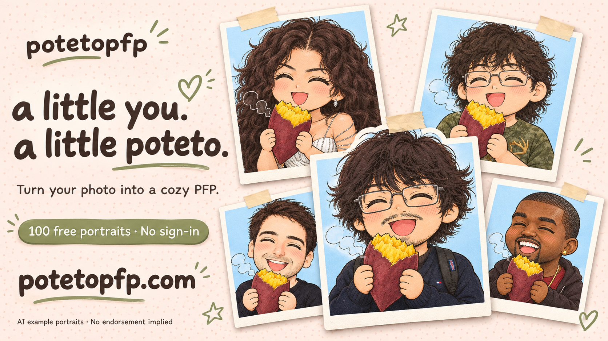
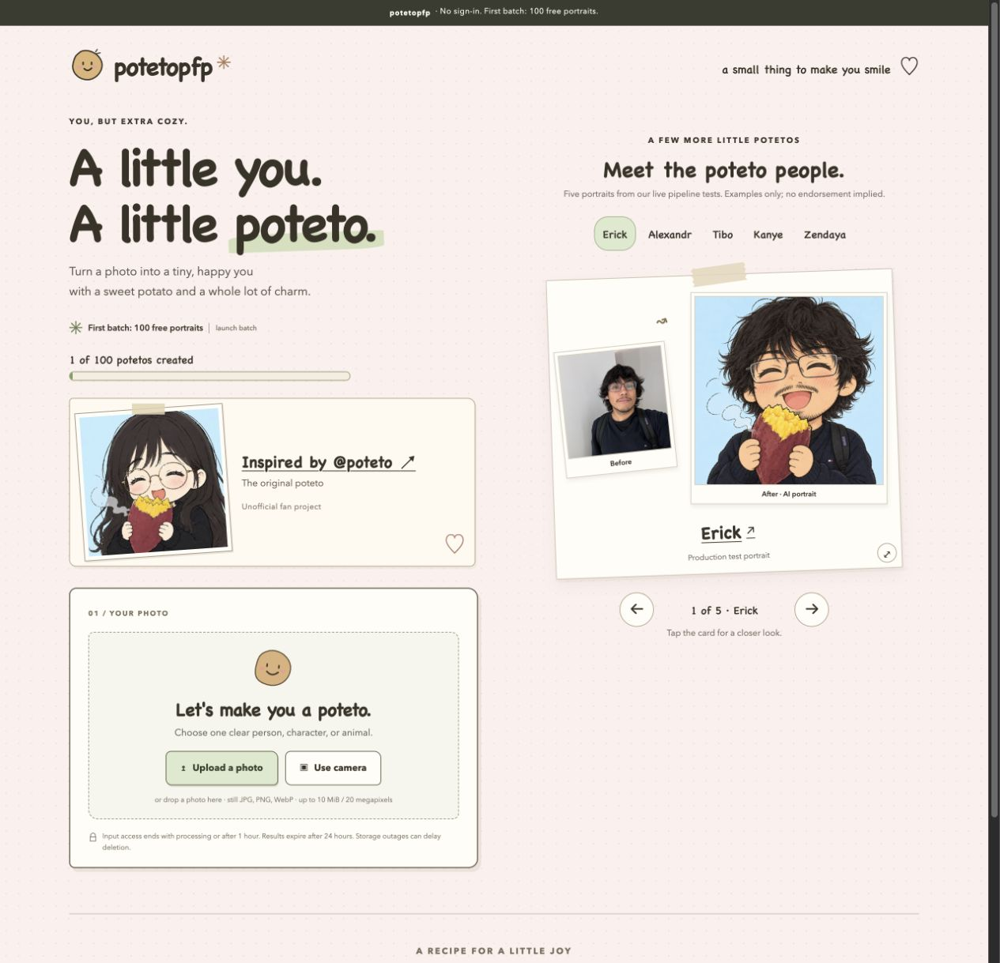
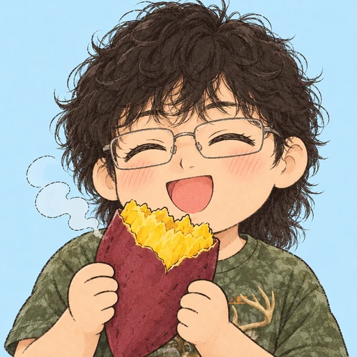
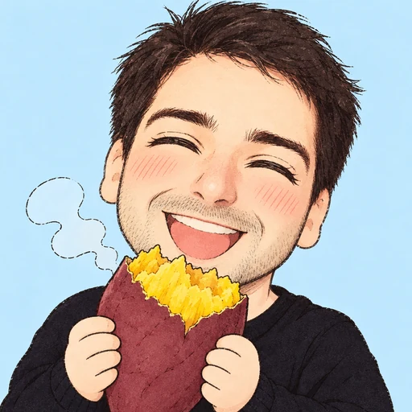
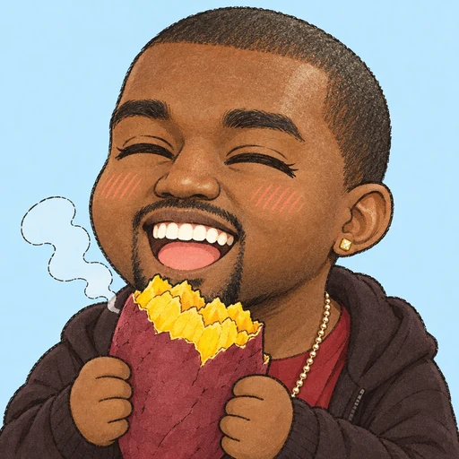
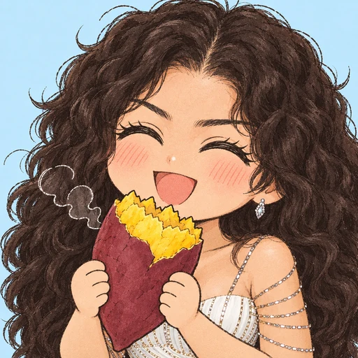

# potetopfp 🍠

**potetopfp is a photo-to-avatar website that gives people a cozy chibi portrait holding a sweet potato.**
Keep your likeness, clothes, and favorite accessories. Get a little poteto for your profile picture.

[Make your poteto](https://potetopfp.com/) · [How it works](docs/architecture.md) · [Validation and limits](docs/validation.md)

Launch artwork. The actual accepted portraits appear below.

This repository presents the project, its design, and accepted example portraits. The hosted app is at **[potetopfp.com](https://potetopfp.com/)**.

## Try it

1. Open [potetopfp.com](https://potetopfp.com/).
2. Upload a photo, or take one with your camera.
3. Confirm the preview and generate your portrait.
4. Give your poteto a name, download it, and share it.

The first batch is free, with **100 successful portraits** available and **no sign-in**. The site shows the current count.
Optional tips help fund future batches. They do not reserve a portrait or reopen a full batch.

## The live site

Live website capture from the GitHub soft launch. The counter changes as portraits finish.

## The experience

- One clear person, character, or animal becomes one square portrait.
- Everyone holds a roasted sweet potato. The person's appearance comes from the uploaded photo.
- A scrapbook showcase lets you compare examples and expand a complete photo card.
- A name adds a personal caption and download filename without changing the portrait.
- “Share on X” opens a draft with the website link. You attach the downloaded portrait before posting.

## A few poteto people

These are accepted outputs from real pipeline tests. They are examples, not endorsements by the people shown.

| [Erick](https://x.com/erickb336) | [Alexandr Wang](https://x.com/alexandr_wang) | [Tibo](https://x.com/thsottiaux) |
| :---: | :---: | :---: |
|  |  |  |

| [Kanye](https://x.com/kanyewest) | [Zendaya](https://x.com/Zendaya) |
| :---: | :---: |
|  |  |

## Built with care

The app uses Cloudflare Workers, Durable Objects, private R2 storage, and a private image processor.
The server controls the generation recipe and provider credentials. Browser requests cannot select the prompt or model.
The pipeline checks the subject before generation and reviews the result before delivery.

The launch uses a 100-success cap and a $40 application AI allowance. The funding limit can pause the batch before all places are used.
Application accounting is a spending control, not a guarantee of the final provider invoice.

See the [architecture](docs/architecture.md) for the flow and the [validation record](docs/validation.md) for what was checked.
This presentation repository has no local app setup. Use the hosted app to try the product.

## Credits

Inspired by [@poteto](https://x.com/poteto). This is an unofficial fan project.
Built by [Erick Benitez-Ramos](https://github.com/erickb336).
The original Poteto has a separate credit on the website; the generator creates a new depiction of the uploaded subject.

## Rights

No open-source or artwork reuse licence is granted by this showcase. See [the rights notice](RIGHTS.md).
