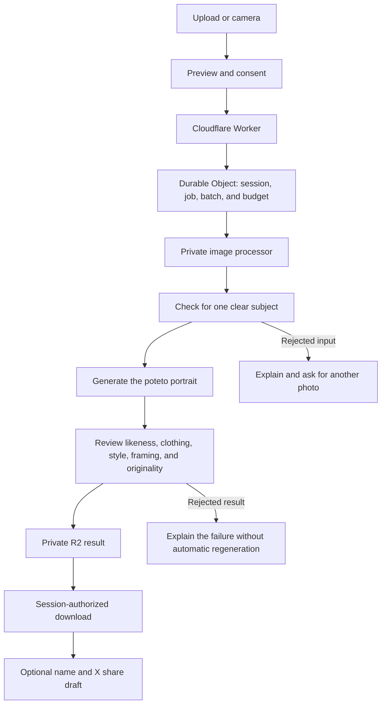

# How potetopfp works

The browser handles the photo preview and download. The server owns the recipe, the job, and the spending controls.

## Main decisions

| Decision | Reason |
| --- | --- |
| One fixed sweet potato and illustration style | Keep a recognizable visual family across different subjects. |
| Server-owned recipe | A browser request cannot choose the model, prompt, output count, or quality settings. |
| Durable jobs and budget reservations | Preserve work and spending state across retries and restarts. |
| Private image storage | Deliver results through the owning browser session instead of public storage URLs. |
| No automatic image regeneration | Avoid turning one click into repeated paid attempts. |
| Guest access for the first batch | Keep the first visit simple. The app does not enforce one portrait per person. |
| Optional hosted Stripe checkout | Accept support without making a tip part of portrait generation. |

## The portrait flow

The image processor normalizes the upload, checks for a single subject, generates one square image, and checks the output.
A scene without a clear person, character, or animal receives an explanation instead of a portrait.
The result check covers likeness, wardrobe, the sweet potato, illustration style, framing, and similarity to the protected original.
These checks reduce mistakes; they cannot guarantee artistic quality, likeness, or originality in every result.

Each admitted request reserves room in the batch. Queued work does not count as a successful portrait.
Only delivered portraits advance the public progress bar. Tips do not change that count or reopen the batch.

## Recovery and cleanup

Uploaded input access ends when processing ends or after one hour. Storage outages can delay physical deletion.
Successful portraits remain available to the owning browser session for 24 hours.
Stopping the wait does not cancel an AI request that already started; the result can remain recoverable in the same browser.
Provider retention is separate from the app's storage policy.

## Public presentation

This repository contains the project presentation and selected compressed portraits.
It does not contain the deployed service, production configuration, provider prompts, credentials, or private job records.
